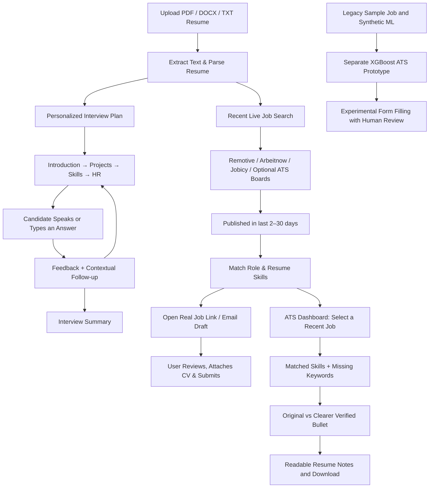

# 🚀 CareerPilot AI

### Resume-Aware Mock Interviews & Intelligent Career Automation

**CareerPilot AI** is an AI-powered career assistance project that brings together **resume-based HR interview practice**, **recent live job discovery**, **job–resume matching**, **resume tailoring**, and **human-reviewed application automation** in one Python-based platform.

The highlight is its **resume-grounded mock interviewer** and a **live recent job finder**: upload your own resume, and the system builds an interview around **your projects, skills, education, and experience** instead of relying on a fixed list of generic questions.

[](https://www.python.org/)
[](https://fastapi.tiangolo.com/)
[](https://groq.com/)
[](https://xgboost.readthedocs.io/)
[](https://playwright.dev/)

---

## ✨ What Makes It Different?

Most interview practice tools ask the same questions to every candidate. CareerPilot AI is designed to **adapt to each uploaded resume** and provide a structured, HR-style conversation.

- 📄 **Upload a resume:** Accepts text-based **PDF, DOCX, and TXT** files, or pasted resume text.
- 🎯 **Personalized interview plan:** Extracts identifiable projects, technical skills, education, and work/internship experience.
- 🎙️ **HR-style practice:** Starts with self-introduction, moves into project and technical discussions, and finishes with behavioral questions.
- 🔁 **Answer-based follow-ups:** Asks contextual follow-up questions; optional Groq integration improves feedback and conversational relevance.
- ⏱️ **40–50 minute practice target:** Designed around a **45-minute interview** with roughly 25–27 main questions and follow-ups. Actual duration varies with candidate responses.
- 📝 **Feedback & summary:** Supports answer evaluation, progress tracking, skipping questions, pausing, and ending the session.

> **Note:** Voice input uses browser speech recognition. Chrome or Edge and microphone permission are recommended; typed answers are also supported.

## 🧩 Platform Capabilities

| Module | What it does | Current scope |
|---|---|---|
| **Resume-Based Mock Interview** | Reads an uploaded resume and generates tailored HR/technical questions | ✅ Usable dashboard feature |
| **Contextual Answer Feedback** | Evaluates responses and suggests follow-up questions | ✅ Basic feedback; richer with Groq |
| **ATS Match & Analysis (dashboard)** | Compares your extracted skills against the selected real recent job; displays a heuristic match indicator, strengths and gaps | ✅ Interactive comparison, not employer ATS output |
| **Separate XGBoost ATS model** | Experimental ML scoring module used outside the main dashboard | 🧪 Trained on synthetic/reference data, not a validated shortlist predictor |
| **Recent Live Jobs** | Public Remotive, Arbeitnow and Jobicy job feeds with known publish dates (optional Lever/Greenhouse board integrations), filtered by resume profile and 2–30 day window | ✅ Live API endpoint (depends on upstream feeds/network) |
| **Direct Apply Links & Email Drafts** | Opens the real source listing or supported employer ATS; creates an email draft only when a listing states an application email | ✅ Human-controlled; no auto-submission |
| **Legacy ATS Sourcing** | Experimental Greenhouse, Lever and Workday modules for the separate `main.py` workflow | 🧪 Prototype, independent from recent-live feed |
| **Resume Tailoring (dashboard)** | Side-by-side original vs clearer wording, verified matching skills, human-reviewable resume notes (.txt) | ✅ Notes/formatting, not a final PDF or full AI STAR synthesis |
| **Separate Typst tailor agent** | Experimental STAR and Typst source-generation module | 🧪 Prototype, outside the live dashboard |
| **Application Automation** | Uses Playwright for form filling and pauses before submission | 🧪 Experimental; human review required |

**Important:** The dashboard shows a **transparent heuristic match indicator** derived from the public job description and extracted resume skills. It does **not** claim to predict hiring. The separate XGBoost model is an experimental, synthetic-data-based prototype.

## 🏗️ How It Works



### Interview Journey

**Introduction** → **Resume projects** → **Technologies and fundamentals** → **Education / experience** → **Behavioral HR questions** → **Closing and summary**

For example, when a resume mentions a **RAG chatbot**, the interviewer can ask what problem it solves, how document retrieval works, which vector database was selected, what difficulties occurred, and how the system was evaluated.

## 🛠️ Tech Stack

| Layer | Technologies |
|---|---|
| **Backend / APIs** | Python, FastAPI, Uvicorn, WebSockets |
| **Frontend** | HTML, CSS, JavaScript |
| **Resume Processing** | pypdf, python-docx, rule-based profile extraction |
| **AI Feedback** | Groq API (optional), heuristic fallback |
| **ML / Matching** | XGBoost, scikit-learn, feature engineering |
| **Career Automation** | Playwright, HTTPX, ATS connectors |
| **Resume Generation** | STAR-based rewriting, Typst source templates |
| **Testing** | Pytest |

## 📁 Project Structure

```text
Project/
├── frontend/
│   └── index.html                 # Web dashboard
├── src/
│   ├── voice_agent.py            # FastAPI server & interview endpoints
│   ├── interview_service.py      # Resume parsing, questions & feedback
│   ├── live_jobs.py             # Recent public job-feed parsing and profile matching
│   ├── scout_agent.py            # ATS sourcing integrations
│   ├── ats_scorer.py             # Experimental job–resume scoring
│   ├── tailor_agent.py           # Resume tailoring and Typst source
│   ├── applicator_agent.py       # Browser automation / HITL
│   ├── orchestrator.py           # Career workflow coordination
│   ├── schemas.py                # Data models
│   └── config.py                 # Application configuration
├── data/                         # Example candidate & job data
├── docs/                         # Architecture and module documentation
├── tests/                        # Automated tests
├── run_server.py                 # Launch local web app
├── main.py                       # Demo career workflow (sample data)
├── requirements-interview.txt    # Lightweight web/interview setup
├── requirements.txt              # Full experimental module dependencies
├── .env.example                  # Environment variable template
└── README.md
```

## 🚀 Run Locally (Windows / VS Code)

### 1. Clone or open the project

```powershell
git clone https://github.com/YOUR_USERNAME/CareerPilot-AI.git
cd CareerPilot-AI
```

Or extract the project ZIP and open its **`Project`** folder in VS Code. All commands below should run from the folder containing `run_server.py`.

### 2. Create a virtual environment

```powershell
python -m venv .venv
.\.venv\Scripts\Activate.ps1
```

### 3. Install the interview dependencies

```powershell
python -m pip install -r requirements-interview.txt
```

### 4. Configure optional AI feedback

```powershell
Copy-Item .env.example .env
```

Open `.env` and optionally set:

```env
GROQ_API_KEY=your_groq_api_key_here
GROQ_MODEL_NAME=llama-3.3-70b-versatile
```

**No API key is required** for resume extraction or the structured interview plan. Never commit `.env` or secrets to GitHub.

### 5. Start the application

```powershell
python run_server.py
```

Open **http://127.0.0.1:8080**, select **Mock Interview**, upload your resume, and click **Start Interview**.

### 🎯 Updated ATS & Resume Tailoring Dashboard

1. **Upload a real resume** (PDF, DOCX or TXT). The ATS dashboard initially shows no target job and no fake score.
2. Open **ATS Match & Analysis**. The center **Recent Jobs Matching Your Resume** card uses the same server-side job feed as **Live Jobs Hub**, rather than a built-in demo company list.
3. Choose **2, 3, 7, 14 or 30 days** in the center card. Click **Refresh** or select any recent job to see its source, published date, required skills, matched skills, missing keywords and original apply link.
4. The **Resume–Job Fit Analysis** shows a **heuristic percentage**, not employer ATS output, shortlist likelihood or guaranteed selection. If there are no jobs, it leaves the score blank rather than inventing listings.
5. Open **Resume Tailoring (STAR)**. The selected ATS job carries across automatically. Compare the original project bullet with a cleaner, verified wording version. The right panel displays an understandable **Improved Resume Notes** preview with a summary, job-relevant skills already found in your CV, and reviewed project text.
6. Use **Copy notes**, **Download .txt**, or **View this job / application page**. Notes are not a replacement for an actual resume. This UI does not add unverified tools, jobs, skills or metrics and does not submit applications automatically.

If no recent public jobs are available, choose a longer range or **Enter Custom Job Description**; custom descriptions are clearly labeled and **not** presented as real job openings.

### 🔎 Real jobs posted in the last 2–3 days

1. Upload your own resume (PDF/DOCX/TXT) in the profile or interview tab. The extracted skills and target role will be reused for live job matching. If present, the contact email is displayed for writing application drafts.
2. Go to **Live Jobs Hub**. The dashboard makes a live server request to `/api/jobs/recent` and initially filters to **jobs posted within the past 3 days**.
3. Switch to **2, 3, 7, 14 or 30 days** and select **All locations / India / Remote** if needed. The results show company, source, location, original posting date, listed job skills and a **transparent heuristic match score**. A 0-result list is a real outcome, not filled with fabricated jobs.
4. Click **Apply on Employer ATS** for configured Lever/Greenhouse postings, or **Open Listing / Apply** for Remotive, Jobicy and Arbeitnow source listings. Check location restrictions and whether applications remain open; a posted listing is not a guaranteed vacancy.
5. If the job description explicitly says to apply through an email, **Draft Email** opens your configured email application with a prefilled recipient, subject and body. It **does not send automatically**; attach your real resume and send yourself, from the account you control. An email on a resume is *not* authorization to send mail from that account.
6. **Mark Applied After Sending** only after you truly submit. This status is a self-reported browser-local marker, not a submission receipt.

**Optional broader company coverage:** Add comma-separated public ATS board slugs to the backend `.env` or Render Environment:

```env
CAREERPILOT_LEVER_BOARDS=your-public-lever-board-slug
CAREERPILOT_GREENHOUSE_BOARDS=your-public-greenhouse-board-slug
```

Only configure real boards that you have validated. These services have different metadata; Greenhouse jobs without a trustworthy published date are excluded rather than mislabeled as recently posted. The default three public feed sources require **no API key**. There is a 10-minute in-process cache of public job listings (not resumes) to reduce repeated load.

**Example API request:**

```bash
curl -X POST http://127.0.0.1:8080/api/jobs/recent \
  -H "Content-Type: application/json" \
  -d '{"candidate":{"role":"Data Scientist","skills":["Python","SQL"]},"days":3,"location":"all"}'
```

Note: This curl command uses Bash quoting. On Windows, use the dashboard directly or an API client. Live source results depend on outbound network access, feed uptime, and their available job dates.

API docs: **http://127.0.0.1:8080/docs**

### Optional: Run the broader career workflow demo

The other ATS, ML, and browser automation modules need additional dependencies:

```powershell
python -m pip install -r requirements.txt
playwright install chromium
python main.py
```

`main.py` currently uses **sample candidate and job data**. It should not be described as a fully autonomous, live job-application service.

## ☁️ Deploy the Interview Dashboard on Render

Create a **Python Web Service** from your GitHub repository.

| Render setting | Value |
|---|---|
| **Root Directory** | Folder containing `src/` and `requirements-interview.txt` |
| **Build Command** | `pip install -r requirements-interview.txt` |
| **Start Command** | `uvicorn src.voice_agent:app --host 0.0.0.0 --port $PORT` |
| **Environment** | Add `GROQ_API_KEY` only if AI-enhanced feedback is needed |

If the repository root already contains those files, leave **Root Directory** empty. Verify the deployed server at **`/api/health`** and then test a real resume upload.

## 🧪 Run Tests

```powershell
python -m pip install -r requirements-interview-dev.txt
python -m pytest tests/test_interview_resume.py tests/test_live_jobs.py -v
```

To run the complete test suite, install dependencies for the additional modules first.

## 🔐 Privacy, Safety & Limitations

- **Review the parsed resume** before starting: scanned/image-only PDFs and unusual layouts can lose information.
- **Keep personal data private:** remove sample resumes containing real contact details before publishing the repository.
- **Optional external AI:** when Groq is configured, interview answers and limited resume context may be sent to its API for evaluation.
- **Real job applications:** the live jobs UI only links to public job sources/ATS systems; it does not promise submission or send mail. Review every recipient and attach the actual resume yourself.
- **Human approval:** the separate experimental application automation also requires human review.
- **No hiring guarantees:** interview feedback is for practice; ATS prototype scores are not real employer decisions.
- **Not production-hardened:** authentication, persistent storage, access controls, and rate limiting should be added before offering a public multi-user service.

## 🗺️ Future Improvements

- More robust resume parsing for complex layouts and scanned documents.
- Persistent interview history and personalized progress analytics.
- Improved voice-based turn taking and real-time speech feedback.
- More India-specific verified company boards, real-world validation, and calibrated job-match models.
- Optional explicit Gmail OAuth integration for authenticated sending (not implemented; no email/password should be pasted into the app).
- Secure multi-user accounts and deployment monitoring.

---

**CareerPilot AI — Practice interviews with your own experience. Explore career automation with human oversight.**

*License: If you intend to publish the project under MIT, add a `LICENSE` file to the repository before displaying an MIT license badge.*

## UI update — October 2026

The dashboard now uses a compact **light blue/white SaaS design** with clearer Live Jobs cards, shorter navigation, a collapsible STAR guide and cleaner ATS / interview views. Core APIs and workflows remain unchanged. See [`UI_REDESIGN_EN.md`](UI_REDESIGN_EN.md) for details.
