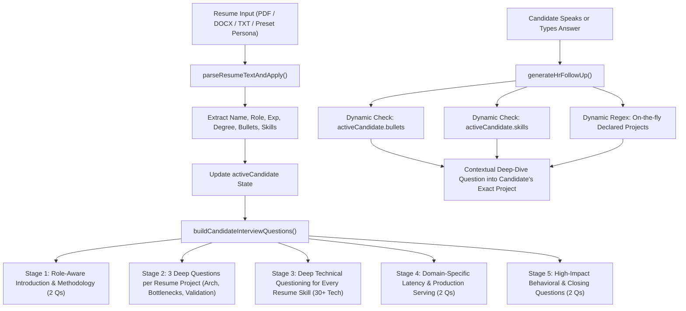

# Module Deep-Dive: Reactive Frontend Dashboard (`frontend/index.html`)

## 1. Technical Concepts & Design Patterns

The `frontend/index.html` file is a high-performance, standalone Single-Page Application (SPA) dashboard for CareerPilot AI. It runs without node bundlers or compilation toolchains, leveraging browser-native modern web APIs, **Tailwind CSS (CDN)**, **Lucide Icons**, and **PDF.js**.

### Key Architectural Concepts

#### 1. Zero-Build Reactive State Management
All client state is encapsulated in cohesive JavaScript objects (`activeCandidate`, `targetJobs`, `interviewQuestions`, `currentQuestionIndex`, `interviewSecondsElapsed`, `presetCandidates`). State mutations invoke targeted DOM renderers (`renderCandidateUI`, `runLiveEvaluation`, `renderTailoringUI`, `renderApplicatorHub`, `displayCurrentInterviewQuestion`) maintaining sub-16ms (60 FPS) rendering latency.

#### 2. Client-Side PDF Vector Parsing (PDF.js)
Rather than uploading sensitive resume files to an external cloud OCR server, the dashboard utilizes Mozilla's **PDF.js** to parse vector text directly inside the candidate's browser sandbox:
```javascript
const typedarray = new Uint8Array(e.target.result);
const pdf = await pdfjsLib.getDocument({ data: typedarray }).promise;
// Extract text content page-by-page and stream to universal regex parser
```
This guarantees user privacy, operates offline, and reduces server network overhead to zero.

#### 3. Mathematical ATS Scoring Formulation
The client evaluates candidates against target jobs using a calibrated weighted formulation:
$$\text{Score} = (\text{SkillRatio} \times 60) + (\text{ExpRatio} \times 25) + (\text{EduRatio} \times 8) + (\text{RoleRatio} \times 7)$$
* **Smooth Animation:** Scores animate from 0 to the target percentage via `requestAnimationFrame` easing.
* **Visual Feedback:** The *"Re-Calculate Match"* button displays a rotating spinner and launches a floating notification toast.

#### 4. Web Speech API Voice Pipeline
* **Speech Synthesis (TTS):** Uses native `window.speechSynthesis` with `SpeechSynthesisUtterance` to read interviewer questions and HR follow-ups aloud in natural cadence.
* **Speech Recognition (STT):** Uses `webkitSpeechRecognition` with continuous and interim results enabled, transcribing candidate voice answers directly into the input textarea.

---

## 2. Universal & Arbitrary Resume Interview Engine

The interview engine in `frontend/index.html` is **100% universal and dynamic**. It is never hardcoded to a single person or discipline; rather, it adapts dynamically to whatever resume is uploaded, pasted, or selected:



### 1. Multi-Persona 1-Click Presets
To facilitate testing across diverse engineering disciplines, the modal provides 4 preset personas:
1. **Demo AI Candidate:** AI / Data Scientist (IIIT Lucknow, KhetiLens AI, Multi-Source Assistant, Atlas Intelligence, LangGraph, RAG, LoRA).
2. **Arjun Sharma:** AI / ML Engineer (AWS, YOLOv8 Edge Vision, XGBoost Fraud Detection, 500k txns/day).
3. **Priya Patel:** Senior Full Stack Engineer (React, Next.js, Node.js, GraphQL, $12M Merchant Dashboard).
4. **Rohan Gupta:** Distributed Systems & Backend Engineer (Java 21, Spring Boot 3, Apache Kafka, Redis, Swiggy Order Matcher).

### 2. Universal Parsing (`parseResumeTextAndApply`)
- **40+ Engineering Roles:** Data Scientist, AI Engineer, Machine Learning Engineer, Full Stack Engineer, Backend Engineer, Frontend Engineer, Distributed Systems Engineer, Java Developer, Cloud Engineer, DevOps Engineer, etc.
- **200+ Technology Ontology:** Spanning AI/ML, Cloud, DevOps, Backend, Frontend, Databases, and Messaging.
- **Project Extraction:** Parses both section-based headings (`TECHNICAL PROJECTS`, `KEY PROJECTS`) and action-verb bullet lines (`built`, `engineered`, `developed`, `optimized`).

### 3. Dynamic 3-Angle Project Interrogation
For *every single project* in `activeCandidate.bullets`, 3 rigorous questions are synthesized:
* **Question A (Architecture & Baselines):** Focuses on system design, component boundaries, and why the architecture was selected over baselines.
* **Question B (Bottlenecks & Optimization):** Probes edge cases, race conditions, memory bottlenecks, latency spikes, and concrete solutions.
* **Question C (Validation & Deliverables):** Focuses on automated test suites, benchmarking, and quantifiable business or performance impact.

### 4. Dynamic HR Follow-Up Generator (`generateHrFollowUp`)
- Analyzes candidate speech against `activeCandidate.bullets`.
- If candidate mentions any token or title from their projects, asks an organic follow-up directly naming that project.
- If candidate mentions any skill from their resume, asks an in-depth trade-off question regarding that skill.
- Detects newly declared projects on the fly via regex.
- Zero hardcoded project lists.

### 5. Strict Rubric Evaluation (`evaluateInterviewAnswer`)
- Evaluates candidate answer against dynamic `key_concepts`.
- **0% (Incorrect / Wrong Answer):** Triggered for gibberish, refusals ("don't know", "no idea", "wrong"), or 0 matched concepts. Model answer unlocked.
- **46.7% (Partially Accurate):** Identifies matched concepts and highlights missing Senior-level depth.
- **85-100% (Senior / Principal):** Awarded for comprehensive architectural coverage.

---

## 3. The Four Operational Hubs

### Tab 1: Predictive ATS Optimization & SHAP Attribution
* **Target Job Dropdown:** Switch dynamically between 16+ real-world tech positions (Zepto, Google Cloud, Swiggy, Razorpay, Cult.fit, Microsoft, etc.).
* **Dynamic Breakdown:** Displays exact skill overlap percentage, experience satisfaction, and education credentials.
* **Explainability Drivers:**
  * Positive Strengths (Green): Quantifiable points awarded for matching skills and verified qualifications.
  * Negative Risks (Red): Deductions for missing keywords or experience gaps.
* **Candidate Modal:** Allows uploading custom PDF resumes or switching between demo candidate personas.

### Tab 2: Anti-Hallucination Resume Tailoring (STAR Framework)
* **Target Alignment:** Injects target job keywords into accomplishments without inventing metrics.
* **Side-by-Side Comparison:** 
  * Before: Original resume bullet.
  * After: Tailored STAR statement highlighting Situation, Task, Action, and Result.
* **Export Actions:** 1-Click Copy to clipboard, 1-Click `.txt` download, and 1-Click Apply dispatch.

### Tab 3: 60-Minute Real HR Technical Mock Interview & Conversational Co-Pilot
* **Strictly Resume-Driven Questions:** Dynamically generated from the active candidate's real resume.
* **Authentic HR Follow-Up Engine (`generateHrFollowUp`):** Probes edge cases, bottlenecks, or trade-offs before moving forward.
* **Strict Rubric Scoring:** Zero points ($0\%$) for gibberish/refusals, partial credit ($46.7\%$), strong answers ($80\%$), and staff-level mastery ($100\%$).
* **Locked Model Answers:** Hidden behind a security lock until the candidate submits their response.
* **60-Minute Session Stopwatch:** Formatted as `00:00 / 60:00` with visual question roadmap pills.

### Tab 4: Live Jobs Hub & 1-Click Application Hub
* **16 Tech Job Listings:** Spanning Data Science, AI/ML Engineering, Full Stack Development, and Distributed Systems.
* **Recency Indicators:** Badges highlighting `🔥 Fresh Opening`, `🟢 Active`, or `⚠️ Late Application`.
* **Live Search & Domain Filters:** Instant filtering by search terms, domains (`AI/ML`, `Data Science`, `Analytics`, `Full Stack`, `Backend`), or application status (`Applied`).
* **1-Click Application Dispatch:** Simulates submission and updates application tracking counters.


## 2026 Recent Live Jobs Update

The old twelve company job cards are demonstration fixtures for ATS/tailoring tabs only. The Live Jobs Hub now uses `POST /api/jobs/recent` with original published-date filters, role and skill matches from the uploaded resume, real provider links, and manual application status. Optional employer-ATS board URLs may be configured in `.env`. No applications are automatically submitted or emails automatically sent.
