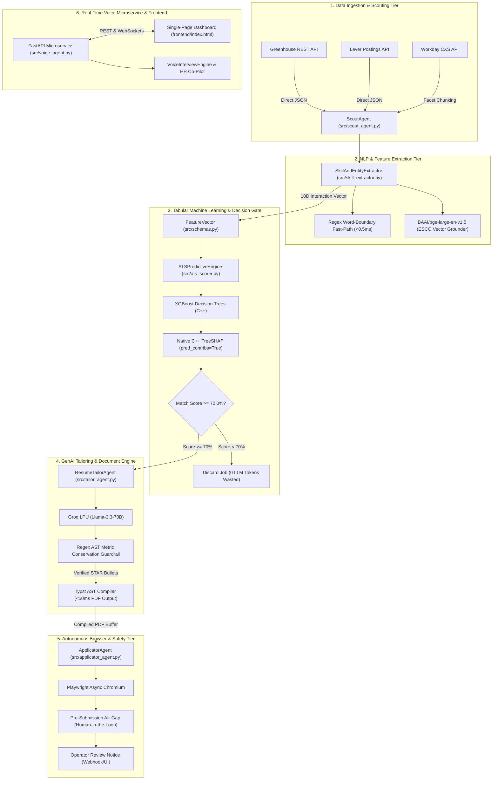
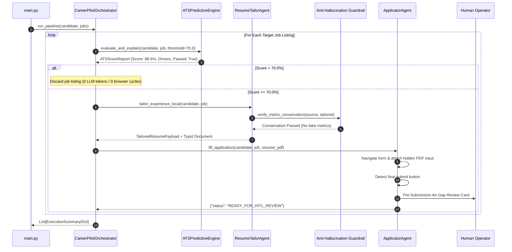
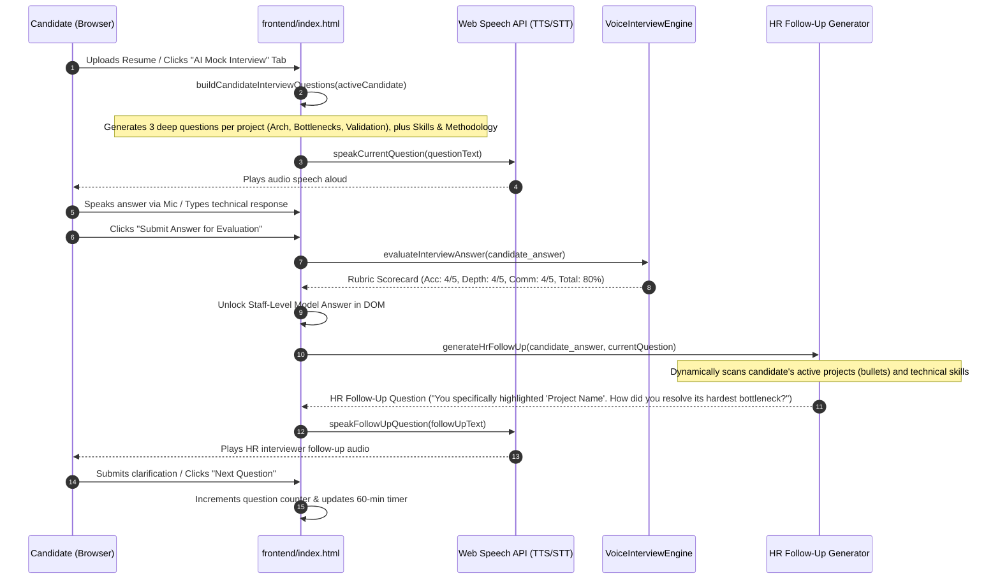
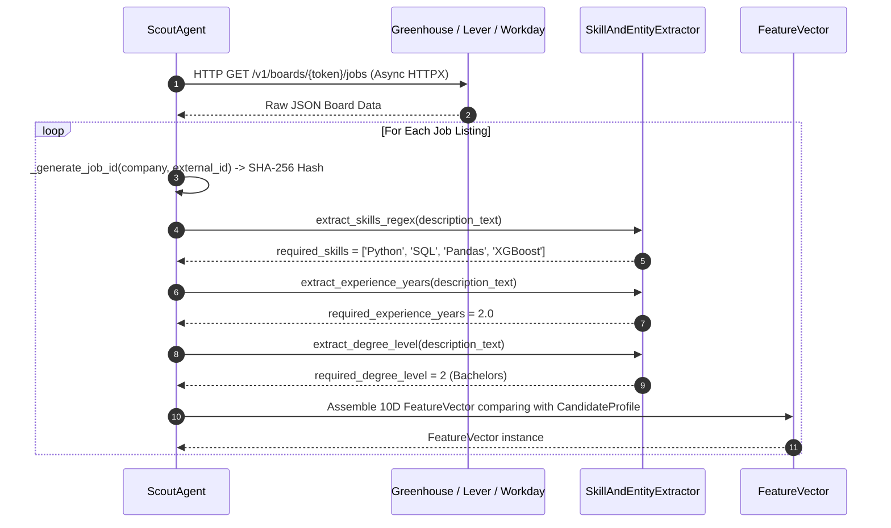

# 03 Architecture and Workflows: CareerPilot AI

## 1. System Architecture & Structural Boundaries

CareerPilot AI is partitioned into five distinct architectural tiers designed to isolate high-throughput network scraping, sub-millisecond tabular prediction, GenAI document compilation, asynchronous browser execution, and real-time audio interaction.

---

## 2. Component Connectivity Map

The table below documents how functions from different scripts invoke one another across architectural boundaries:

| Calling Module & Function | Invoked Target Function & Module | Data Passed | Architectural Purpose & Trigger Condition |
| :--- | :--- | :--- | :--- |
| `main.py:main()` | `CareerPilotOrchestrator.run_pipeline` (`src/orchestrator.py`) | `CandidateProfile`, `List[JobPosting]` | Kicks off the automated batch candidate evaluation lifecycle. |
| `orchestrator.py:run_pipeline()` | `ATSPredictiveEngine.evaluate_and_explain` (`src/ats_scorer.py`) | `candidate`, `job`, `threshold=70.0` | Evaluates match probability and extracts Shapley drivers before any LLM is called. |
| `ats_scorer.py:evaluate_and_explain()` | `ATSPredictiveEngine.compute_features` (`src/ats_scorer.py`) | `candidate`, `job` | Computes the 10-dimensional numerical feature vector comparing credentials. |
| `ats_scorer.py:compute_features()` | `FeatureVector.to_numpy` (`src/schemas.py`) | `FeatureVector` instance | Converts Pydantic model into a 2D `float32` array shaped `(1, 10)` for XGBoost. |
| `ats_scorer.py:evaluate_and_explain()` | `xgb.Booster.predict` (`xgboost` C++ runtime) | `dmat`, `pred_contribs=True` | Extracts exact additive Shapley feature attributions in $<0.3\text{ ms}$. |
| `orchestrator.py:run_pipeline()` | `ResumeTailorAgent.tailor_experience_local` (`src/tailor_agent.py`) | `candidate`, `job` | Triggered **only** when `match_percentage >= 70.0%` to generate STAR achievements. |
| `tailor_agent.py:tailor_experience_local()` | `ResumeTailorAgent._call_groq_star_rephrase` (`src/tailor_agent.py`) | `raw_bullet`, `target_role`, `target_skills` | Calls Groq LPU API (Llama-3.3-70B) to rephrase bullets into active STAR sentences. |
| `tailor_agent.py:tailor_experience_local()` | `ResumeTailorAgent.verify_metric_conservation` (`src/tailor_agent.py`) | `source_bullets`, `tailored_bullet` | Anti-Hallucination Guardrail: Rejects bullets if fabricated numbers are detected. |
| `orchestrator.py:run_pipeline()` | `ResumeTailorAgent.export_to_typst` (`src/tailor_agent.py`) | `TailoredResumePayload` | Compiles tailored candidate data into high-aesthetic Typst markup. |
| `orchestrator.py:run_pipeline()` | `ApplicatorAgent.fill_application` (`src/applicator_agent.py`) | `candidate`, `job`, `resume_pdf_path` | Launches Playwright Chromium to navigate the target job application portal. |
| `applicator_agent.py:fill_application()` | `ApplicatorAgent._handle_file_upload` (`src/applicator_agent.py`) | `page`, `file_path` | Binds the PDF directly into `input[type="file"]`, bypassing CSS overlays. |
| `applicator_agent.py:fill_application()` | `ApplicatorAgent._pre_submission_airgap` (`src/applicator_agent.py`) | `page`, `job` | Enforces Human-in-the-Loop safety halt immediately before the final submit button. |
| `frontend/index.html:evaluateInterviewAnswer()` | `VoiceInterviewEngine.evaluate_answer_local` (`src/voice_agent.py`) | `question_id`, `candidate_answer`, `role` | Evaluates candidate answer against strict rubrics (0% for refusals/gibberish). |
| `frontend/index.html:evaluateInterviewAnswer()` | `generateHrFollowUp` (`frontend/index.html`) | `candidate_answer`, `currentQuestion` | Analyzes candidate technical mentions and generates an organic HR follow-up question. |

---

## 3. Execution Lifecycle & Primary Workflows

### Workflow 1: End-to-End Autonomous Application Pipeline
This workflow traces a candidate's verified record from CLI invocation to the Human-in-the-Loop browser air-gap:

#### Detailed Execution Steps
1. **Trigger Condition:** The operator executes `python main.py`.
2. **Step 1 (Ingestion):** `main.py` deserializes `data/sample_resume.json` into a strictly typed `CandidateProfile` and loads candidate target positions from `data/sample_job.json`.
3. **Step 2 (Feature Extraction):** For each job, `Orchestrator` calls `ATSPredictiveEngine.compute_features()`. It computes set intersections between candidate skills and required skills, experience differentials, degree rank deltas, and token overlap proxies, producing a 10D `FeatureVector`.
4. **Step 3 (Sub-Millisecond Inference & TreeSHAP):** `xgb.Booster.predict()` runs in $<1.5\text{ ms}$. Native TreeSHAP (`pred_contribs=True`) calculates exact Shapley values.
5. **Step 4 (Conditional Gating):** If the score is $<70\%$, the listing is discarded immediately.
6. **Step 5 (STAR Rephrasing & Guardrail Verification):** If $\ge 70\%$, `ResumeTailorAgent` invokes Groq LPU to rephrase bullets into active STAR accomplishments. The text passes through `verify_metric_conservation()`; if unauthorized numbers are detected, the bullet is rejected.
7. **Step 6 (Typst Compilation):** The tailored payload compiles to Typst markup.
8. **Step 7 (Browser Navigation & Safety Air-Gap):** `ApplicatorAgent` launches Chromium, auto-fills form locators, binds the PDF to `input[type="file"]`, and halts execution at the final submit button.

---

### Workflow 2: Dynamic Resume-Driven Mock Interview & HR Follow-Up
This workflow traces a real-time conversational mock interview session in `frontend/index.html`:

#### Detailed Execution Steps
1. **Trigger Condition:** The candidate switches to Tab 3 (*"AI Mock Interview"*), switches demo candidate personas, or uploads a new resume (.pdf, .docx, or raw text).
2. **Step 1 (Dynamic Universal Question Queue Construction):** `buildCandidateInterviewQuestions()` inspects `activeCandidate`. It generates introductory questions referencing the candidate's exact degree, target role, and engineering methodology, constructs **3 dedicated deep-dive questions for *every single project* in `activeCandidate.bullets`** (Architecture & Component Selection, Bottlenecks & Optimizations, and Validation & Deliverables), and generates targeted technical questions for *every single skill* in `activeCandidate.skills` across 30+ technical disciplines with dynamic fallback for arbitrary tools.
3. **Step 2 (Speech Synthesis):** `speakCurrentQuestion()` synthesizes question audio using the Web Speech API.
4. **Step 3 (Answer Submission & Anti-Inflation Evaluation):** The candidate speaks or types their answer. `evaluateInterviewAnswer()` dynamically extracts candidate name, education, projects, and skills if Question 1 (Introduction), checks for refusals or gibberish (strictly awarding $0/5$ and $0\%$ if detected), or matches core engineering concepts to award calibrated credit.
5. **Step 4 (Model Answer Unlock):** The staff-level model answer is revealed in the scorecard.
6. **Step 5 (Conversational HR Probing):** `generateHrFollowUp()` dynamically matches tokens against `activeCandidate.bullets` and `activeCandidate.skills`. If the candidate mentions any of their uploaded projects or declared skills, the AI interviewer behaves like an authentic human hiring manager, asking a targeted follow-up digging deeper into architectural trade-offs, scalability, or edge cases.
7. **Step 6 (Progression):** The candidate clarifies their response (receiving a depth bonus) and advances to the next resume topic while the 60-minute session timer (`00:00 / 60:00`) records duration.

---

### Workflow 3: Multi-Platform ATS Scouting & Feature Vector Construction
This workflow traces the extraction of external job openings into normalized mathematical feature vectors:

#### Detailed Execution Steps
1. **Trigger Condition:** Periodic scheduled ingestion or candidate search query.
2. **Step 1 (Direct API Request):** `ScoutAgent` issues an asynchronous HTTP GET request to Greenhouse or Lever REST endpoints without launching a browser.
3. **Step 2 (Content Deduplication):** `ScoutAgent._generate_job_id()` computes a 16-character SHA-256 hash from `company:external_id`, preventing duplicate insertions.
4. **Step 3 (Entity Extraction):** `SkillAndEntityExtractor` extracts required hard technical skills via regex word boundaries, required years of experience, and minimum academic degree levels.
5. **Step 4 (Normalization):** Creates a normalized `JobPosting` record ready for tabular feature vector construction and XGBoost classification.
